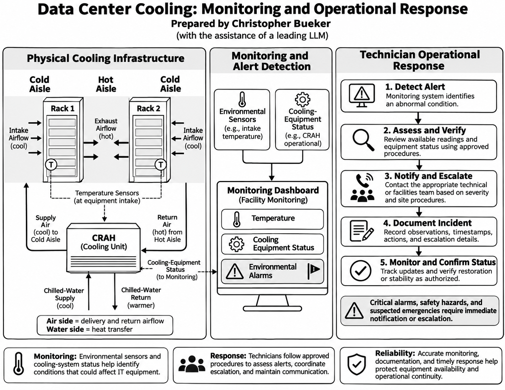
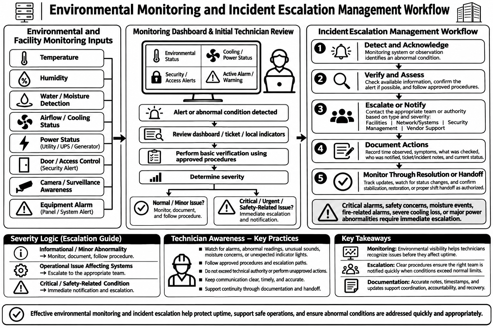

**Data Center Cooling Operations Overview**

Data center cooling systems, environmental monitoring, operational response, and incident escalation explained.

**Context**

Data centers are mission-critical infrastructure that support businesses, public safety services, communication networks, and many of the modern technologies that keep today's world operating. Maintaining these facilities requires reliable power, cooling, monitoring, and operational procedures designed to protect equipment and ensure business continuity.

An important part of data center operations is maintaining proper cooling to prevent equipment from overheating. This reduces operational risks and supports reliable system performance. As demand for computing infrastructure grows, energy efficiency, sustainability, and effective cooling management are becoming increasingly important to businesses and local communities.

In this repository, I examine how air cooling and chilled-water systems work together, the role of environmental monitoring systems, and the incident escalation procedures used to improve response times, support efficient troubleshooting, maximize uptime, and maintain operational efficiency and profitability.

**Objectives**

- Explain how room air cooling, hot-aisle/cold-aisle airflow management, and chilled-water systems work together to remove heat from IT equipment and maintain safe operating temperatures.
- Explore how temperature, humidity, moisture detection, cooling equipment status, and other environmental monitoring systems help technicians identify abnormal conditions and protect critical infrastructure.
- Demonstrate how technicians identify, verify, document, and escalate abnormal conditions through established procedures to support timely incident response and resolution.
- Examine how effective cooling, monitoring, and incident management reduce operational risks, minimize disruptions, and support reliable business operations.

**Data Center Cooling: Monitoring and Operational Response**

- Illustrates how cool air enters server racks, absorbs equipment heat, and returns to the CRAH cooling unit, where heat is transferred into the chilled-water system.
- Shows how chilled water enters the CRAH cooling coil and returns warmer to the cooling plant, while temperature sensors and equipment-status monitoring provide operational visibility.
- Demonstrates how technicians assess cooling alerts, notify appropriate teams, document incidents, and monitor conditions.

**Environmental Monitoring and Incident Escalation Management Workflow**

- Identifies critical facility conditions, including temperature, humidity, moisture, cooling, power, physical security, and equipment alarms.
- Shows how technicians review monitoring information, verify conditions, determine severity, and escalate abnormalities according to established procedures.
- Explains how timely communication, accurate ticket documentation, monitoring, and shift handoffs support incident resolution, operational continuity, and data center uptime.

**Reflection**

In this project, I document how room air cooling, hot-aisle/cold-aisle airflow, and chilled-water systems work together to maintain safe and reliable data center operations.

I review the monitoring processes involving temperature, humidity, moisture detection, cooling equipment, and power systems.

The operational workflows that I show here cover alert detection, condition verification, incident escalation, documentation, and follow-up monitoring.

These processes demonstrate how technicians use standardized procedures, efficient communication, and structured troubleshooting to support reliable and profitable data center operations.

**Summary**

In this project, I provide an overview of how data center cooling systems, environmental monitoring, and incident escalation procedures work together to support reliable data center operations.

Maintaining these facilities requires effective cooling systems, continuous monitoring, standardized operational procedures, and trained personnel who can identify issues, troubleshoot, and respond accordingly.

Properly trained technicians play an important role in protecting equipment, coordinating incident response, minimizing disruptions, and maximizing business uptime.

Together, these practices help businesses improve infrastructure reliability, maximize uptime, protect their investments, and support efficient business operations.

**Navigation**

[`Back to GitHub Profile`](https://www.github.com/cbueker-it)

